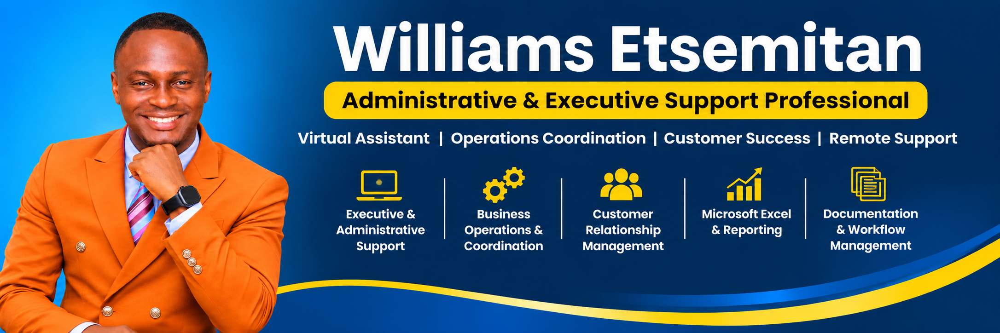

  

# Hello, I'm an Administration & Operations Professional 👋

### Administrative Support | Virtual Assistance | Operations Coordination | Remote Work

Welcome to my GitHub portfolio!

I am an administrative and operations professional with experience in business operations, office administration, documentation, record management, customer service, reporting, and team coordination.

I enjoy creating organised systems, improving administrative processes, managing information, and helping businesses operate efficiently.

## 💼 Professional Skills

### Administrative & Executive Support
- Executive Assistance and Administrative Support
- Calendar and Meeting Coordination
- Email and Correspondence Management
- Document Preparation and Management
- Data Entry and Record Keeping
- Travel and Appointment Coordination

### Business Operations & Coordination
- Daily Operations Management
- Workflow and Task Coordination
- Customer Relationship Management
- Customer Service and Complaint Resolution
- Order Processing and Follow-up
- Performance Monitoring and Reporting

### Reporting & Data Management
- Microsoft Excel Reporting
- Data Organisation and Record Management
- Spreadsheet Management
- KPI Tracking and Performance Reports
- Business Documentation

### Communication & Professional Skills
- Written and Verbal Communication
- Time Management and Prioritisation
- Attention to Detail
- Problem-Solving
- Confidentiality and Professionalism
- Remote Team Collaboration

## 🛠️ Tools & Technology

| Category | Tools |
|---|---|
| Office Productivity | Microsoft Word, Excel, PowerPoint |
| Collaboration | Google Workspace, Zoom, Microsoft Teams |
| Design | Canva |
| Documentation | Microsoft Office, Google Docs, Google Sheets |
| Workflow Management | Task Trackers, Administrative Reporting Systems |

## 🌍 Career Interests

- Remote Executive Assistant
- Virtual Assistant
- Administrative Assistant
- Operations Coordinator
- Customer Success Support

### 📂 My Portfolio Projects

I am developing practical projects that demonstrate my administrative and operational capabilities.

1. Administrative Management Toolkit
2. Employee Attendance and Leave Tracker
3. Meeting and Appointment Management System
4. Document and Records Management System
5. Project and Task Management Tracker
6. Business Reporting Dashboard

### 🎯 Professional Goal

I am interested in remote opportunities in administrative support, virtual assistance, executive assistance, operations coordination, and business support.

I believe in organisation, accountability, continuous learning, and delivering quality work.

### 📫 Let's Connect

I welcome opportunities to collaborate, learn, and contribute to businesses that value efficiency and professional excellence.
